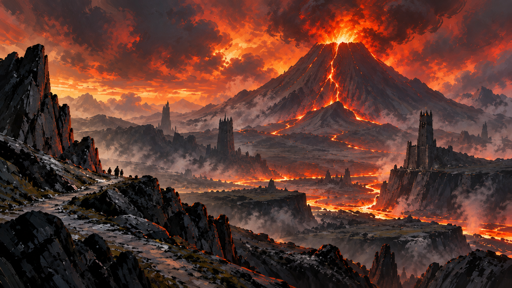

<p align="center">
  
</p>

# Omarchy Tolkien Theme

An Omarchy theme for dark terminals and Middle-earth light. Tolkien sits on near-black earth. Parchment is the ink. Ember, moss, and a violet accent mark the rest.

## Install

```sh
omarchy-theme-install https://github.com/csfh/omarchy-tolkien-theme
```

You can also install it from the Omarchy menu with `Super + Alt + Space`, then `Install > Style > Theme`, using this repository URL:

```text
https://github.com/csfh/omarchy-tolkien-theme
```

## Palette

| Role | Hex |
| --- | --- |
| Background | `#0e0502` |
| Foreground | `#e7d3ca` |
| Accent | `#a372bc` |
| Red | `#d9815c` |
| Green | `#6b994a` |
| Yellow | `#28abd2` |
| Magenta | `#fb8b5a` |
| Cyan | `#00c1f3` |

## Included

Desktop, terminal, editor, launcher, notification, bar, lock screen, browser, Discord, and TUI theme files for Omarchy:

`alacritty`, `btop`, `chromium`, `foot`, `ghostty`, `gtk`, `hyprland`, `hyprlock`, `kitty`, `mako`, `neovim`, `swayosd`, `vencord`, `vscode`, `walker`, `warp`, `waybar`, `wofi`, and `zellij`.

## Backgrounds

The wallpapers are original illustrations at 8K (8192 px wide):

- [`orodruin`](backgrounds/orodruin.webp) — the mountain of fire
- [`mornatárië`](backgrounds/mornatárië.webp) — the spider and the crowned shadow
- [`barrow-downs`](backgrounds/barrow-downs.webp) — standing stones in the mist
- [`minas-morgul`](backgrounds/minas-morgul.webp) — the moonlit citadel
- [`riddles-in-the-dark`](backgrounds/riddles-in-the-dark.webp) — Gollum on the underground lake

## License

MIT. See [LICENSE](LICENSE). Copyright (c) 2026 Christoffer Hallas.

If you send a pull request or other contribution, you agree to the [CLA](CLA.md).
